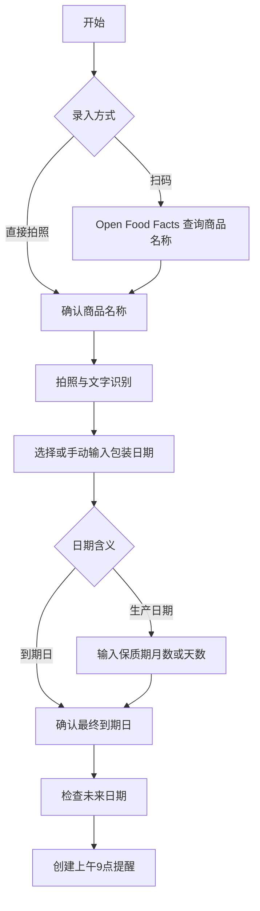

# 保质期管家 · Shelf Life Shortcuts

用 iPhone 扫码查询商品名称、拍摄包装识别日期，再把到期提醒写入 Apple「提醒事项」。无需自建服务器、API Key 或付费订阅。

**当前版本：0.1.0 开源试用版。** 已完成 Mac 编辑器修复、结构校验与 Apple「任何人」签名；尚未完成 iPhone 扫码、相机、OCR、提醒写入的端到端实测。欢迎提交测试结果。

## 下载与安装

[下载保质期管家.shortcut](https://github.com/jasonbitsmith/shelf-life-shortcuts/raw/refs/heads/main/downloads/%E4%BF%9D%E8%B4%A8%E6%9C%9F%E7%AE%A1%E5%AE%B6.shortcut)

1. 在 iPhone Safari 下载文件，通过分享菜单或文件 App 用「快捷指令」打开并添加。若浏览器显示源码，请使用文件下载链接。
2. 在 Apple「提醒事项」新建列表 **保质期管理**。
3. 编辑快捷指令，找到靠近末尾的两处「添加提醒事项」，分别将列表选为 **保质期管理**。公开版没有绑定作者的个人列表；未设置时可能使用你的默认列表。
4. 首次运行，根据系统提示允许相机、网络访问和提醒事项访问，并在系统设置开启提醒事项通知。
5. 用一个普通商品试运行，在提醒事项核对标题、日期、上午 9 点通知及目标列表。

目标设备为带「快捷指令」、相机、图像文字识别和「提醒事项」的 iPhone。开发环境为用户提供的 iOS 27 / Mac 快捷指令；其他版本尚未验证。Mac 可编辑和签名，完整扫码拍照流程请在 iPhone 使用。

## 功能

- 扫描条形码，查询 Open Food Facts 的中文或其他商品名称；也可跳过联网直接拍照。
- 商品名称可手动确认和填写。
- 包装照片文字识别；将连续八位日期（如 20261012）规范为 2026-10-12，再使用系统日期识别。
- 多个识别日期可选择，并再次核对。
- 支持「包装日期就是到期日」「生产日期＋月数」「生产日期＋天数」。
- 最终到期日再次确认，统一设置当天上午 9 点提醒。
- 到期日在未来时添加【到期】提醒；提前 30 天的日期仍在未来时另加【临期】提醒。
- 提醒备注包含条码、到期日与识别文字，便于复核。



## 使用边界

- 条码数据库主要覆盖食品，可能查不到国内商品、化妆品或药品；查不到时手动填名称。
- **网络请求失败可能直接中断快捷指令**，目前没有自动捕获网络错误；无网络时选「直接拍照」。
- OCR 不能保证区分生产日期、到期日期、批号或开封后期限。所有日期必须按实际包装复核。
- 不自动理解「开封后 6M」、复杂保质期文案或批次信息。开封期限更短时请手动修改最终日期。
- 重复运行会重复创建提醒；当前不去重，也没有库存数量、批量导入或后台扫描。
- 已经过期的商品不会创建未来通知，会提示检查日期。
- 通知是否弹出取决于提醒事项权限、系统通知及专注模式等设置。

## 隐私与第三方服务

扫码路径仅将商品条码作为查询参数发给 [Open Food Facts](https://world.openfoodfacts.org/)，该服务也会接收正常网络连接信息。代码中没有上传包装照片的步骤；文字识别调用 Apple 系统操作。商品名称、条码和 OCR 文字会保存到你自己的提醒事项；启用 iCloud 的列表可能按你的系统设置同步。

不需要输入 Apple ID 密码、第三方账号密码或 API Key。项目不包含开发者的照片、聊天记录、个人提醒事项列表标识或访问凭据。

## 项目文件与开发

| 路径 | 用途 |
| --- | --- |
| `downloads/保质期管家.shortcut` | Apple 签名、可导入文件 |
| `src/保质期管家.plist` | 可编辑的 XML 工作流源码，发布源文件 |
| `src/workflow.json` | 同一工作流的可读 JSON 快照 |
| `scripts/build.py` | 结构检查、JSON 更新和 Mac 本地签名 |
| `docs/PROJECT.md` | 项目总结、修复记录和测试清单 |

只校验源码：

```sh
python3 scripts/build.py --check
```

在已登录 iCloud 的 Mac 上重新构建（签名需要 Apple 服务）：

```sh
python3 scripts/build.py
```

修改 XML 源码后重新构建；或在「快捷指令」编辑器修改并导出，再更新源码及 JSON。`shortcuts sign --mode anyone` 使用 Apple 的公开分享签名。Apple 工作流格式随系统版本变化，源码结构校验不等于设备实测。

## 贡献与许可证

欢迎通过 Issues 报告设备、系统版本、执行步骤、报错位置和实际结果。截图请遮住个人信息，勿上传密码或私密照片。

项目代码和原创工作流采用 [MIT License](LICENSE)，可以使用、修改和再分发。Apple 软件与 Open Food Facts 服务、内容分别适用各自条款；MIT 不重新授权第三方数据。
